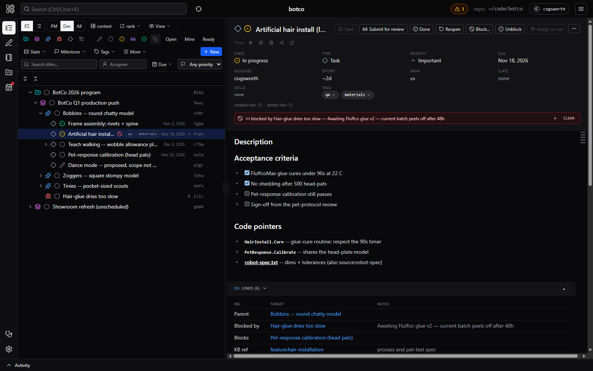
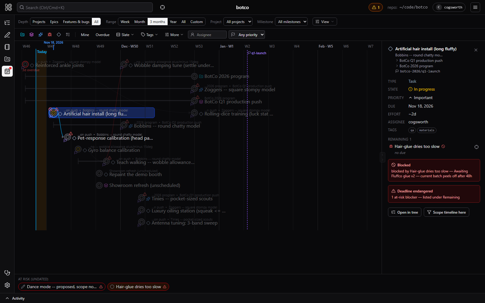
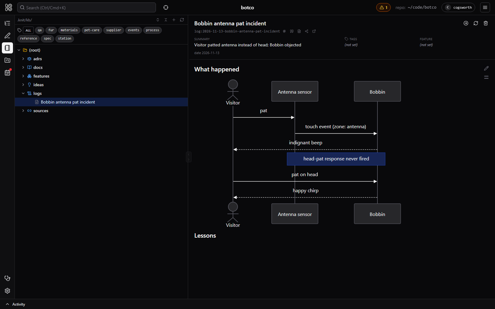

<p align="center">
  <picture>
    <source media="(prefers-color-scheme: dark)" srcset="assets/logo/logo-dark.svg">
    
  </picture>
</p>

# Knit

Git-native task tracker and knowledge base. Items, ADRs, and design docs
are plain markdown in your repo. Single binary CLI built for AI agents,
plus a local web UI for humans.

**Not just code** — Knit tracks any project work (reports, research,
client engagements, follow-ups), not only software. See
[Concepts](#concepts) for what items, buckets, and designs are.



| Section | What's in it |
|---|---|
| [Why Knit](#why-knit) · [Status](#status) | What it is for, how far along it is |
| [Install](#install) · [Quick start](#quick-start) | Get the binary, set up a repo, first steps |
| [Demo](#demo-robot-factory-seed) | A seeded sample project to explore |
| [For AI agents](#for-ai-agents) | The bundled agent skills and how to install them |
| [Concepts](#concepts) | Items, planning, the knowledge base, designs |
| [Settings](#settings) | `knit config`, the global config and where it lives |
| [Web UI](#web-ui) · [CLI commands](#cli-commands) | `knit web`, the command groups, filters, `--json` |
| [Advanced setups](#advanced-setups) | Shared trackers and worktrees, files outside the repo, share links |
| [Reference](#reference) | On-disk layout, concurrency, format version, links, search |
| [Limitations](#limitations) · [Troubleshooting](#troubleshooting) | Known gaps, error codes, debugging |
| [Contributing](#contributing) · [License](#license) | Building from source, licensing |

## Why Knit

Hosted trackers keep the plan outside the repo, behind an API an agent needs
credentials for, and out of step with the branch the code is on; a plain
`TODO.md` stays in the repo but gives an agent nothing to query. Knit sits
between: every item, decision and design is a markdown file versioned with the
code, reviewed in the same pull request and readable without Knit — while a CLI
with `--json` on every command and a bundled skill set give agents a precise
way to read and change it. Beyond tasks it keeps a knowledge base (ADRs,
feature docs, logs) and design docs, and plans above the item with projects,
milestones and slates.

## Status

Pre-1.0. Usable day to day on a single repo — the CLI, the knowledge base,
design docs, projects / milestones / slates, the deadline timeline,
`knit status` and the web UI. Commands and flags may still change between
`0.x` releases; the on-disk format is versioned, and a repo written by a newer
format is refused, never misread (see [Format version](#format-version)).
Roadmap in [design/roadmap.md](design/roadmap.md).

## Install

Download the binary for your platform from the project's releases page:

- Linux: `knit-linux-x64`
- Windows: `knit-win-x64.exe`
- macOS: `knit-osx-arm64`

It is self-contained — no .NET or Node runtime to install. Make it executable
(Linux/macOS) and put it on your PATH:

- Linux/macOS: `~/.local/bin/knit`
- Windows: `%LOCALAPPDATA%\Programs\Knit\knit.exe`

Keeping the binary next to a project instead? Name the folder `.knit-bin`
(and gitignore it), never `.knit` — that name marks a knit repo, so a directory
of binaries sitting where the tool looks for a tracker is confusing at best.

Full steps — PATH, macOS quarantine, skills, updating — in
[INSTALL.md](INSTALL.md). Until the first release is published, build the binary
from source — see [CONTRIBUTING.md](CONTRIBUTING.md).

## Quick start

```bash
cd <your-repo>
knit init      # asks your handle, offers the agent skills and an agent pointer
knit web       # browse and edit the tracker in the local web UI
```

`knit init` installs the skill bundle for the agents it finds — Claude Code,
Codex, OpenCode, recognized by their folders in the repo or your home dir;
Claude Code if it finds none — either globally or into this repo, and offers a `## Knit` section in
`CLAUDE.md` / `AGENTS.md` so an agent discovers the tracker. From there, ask
your agent to plan and track work in Knit. Details and other agents:
[For AI agents](#for-ai-agents); every install step in [INSTALL.md](INSTALL.md).

### First steps in the CLI

```bash
knit add feature "Add dark mode"
knit add task "Implement toggle" --parent <feature-id-prefix> \
    --assignee me --due 2026-09-01 --priority important   # fields at create time
knit start <task-id>                   # in-progress, assigned to you
knit ready --mine                      # what can I pick up now?
knit tree --under <feature-id>         # focus on one subtree
knit done $(knit pick --mine --state in-progress)   # arrow-key picker
knit done <task-id>
git add .knit && git commit -m "knit: tasks for dark mode"
```

You stage and commit `.knit/` changes yourself — same workflow as
editing any other file.

## Demo: Robot Factory seed

Want a populated project to poke at? The repo ships a self-contained
seed script that fills an empty Knit project with a small Robot
Factory dataset — an epic with three robot features (Bobbins,
Zoggers, Tinies) and a four-level task/subtask tree, a bug, ADRs with
a supersede chain, a split feature doc, log + idea + source entries
(one pointing at a real `docs/robot-spec.txt` the web file-viewer can
open), an active design doc plus an archived one, a partially-checked
acceptance checklist, prose descriptions, a comment thread, work
spread across a small team (cogsworth / sparky / rusty), and one
deliberate dangling ref for `knit verify` to flag.

It also covers planning and scheduling: due dates (overdue / due-soon
/ future), priorities, tags, two slates (one active, one planned), and
a `BotCo 2026` project doc folder — readme + roadmap + two milestones
(a reached pilot, a planned Q1 launch) with the Q1 epic parented under
it and a couple of todos hanging off it — plus a deliberately unfiled
tree so the timeline's hide-disconnected view has something to drop.
So `knit tree`, `knit context`, `knit kb show`, `knit timeline`,
`knit status`, and `knit web` all have something lived-in to render.

Workflow (the script needs PowerShell — see [Limitations](#limitations)):

1. Make an empty folder for the demo.
2. Copy `demo/seed-robot-factory.ps1` into it.
3. Copy the `knit` binary (`knit.exe` on Windows) into the same
   folder, **or** have `knit` on `PATH`.
4. From inside the folder:

   ```pwsh
   knit init
   ./seed-robot-factory.ps1
   ```

The script refuses to run without `.knit/` and prompts before
clearing existing items / KB / designs (`config.json` and installed
skills are never touched). Pass `-Yes` to skip the prompt.

`knit tree` on the demo — the same data as the screenshots:

```
knit
├── ◆ ○ 0i6p BotCo 2026 program (at-risk)
│   ├── ▣ ○ 9wuy BotCo Q1 production push
│   │   ├── ◈ ○ xfmr Bobbins -- round chatty model
│   │   │   ├── ▸ ✓ fgpp Frame assembly: rivets + spine 2026-11-03
│   │   │   ├── ▸ ◐ frpv Artificial hair install (long fluffy) ⊘ ▲ 2026-11-18
│   │   │   ├── ▸ ○ c79w Teach walking -- wobble allowance plus/minus 15deg 2026-12-03
│   │   │   │   ├── ▸ ◐ aof1 Gyro balance calibration 2026-11-25
│   │   │   │   └── ▸ ○ 5n2u Wobble damping tune (settle under 2s) 2026-12-08
│   │   │   ├── ▸ ○ oole Pet-response calibration (head pats) 2026-11-22
│   │   │   └── ▸ ✎ q3gr Dance mode -- proposed, scope not agreed
│   │   ├── ◈ ○ 7phw Zoggers -- square stompy model
│   │   │   ├── ▸ ○ 6vz9 Reinforced ankle joints ⚠ 2026-11-10
│   │   │   ├── ▸ ○ 29ca Rolling-dice training (luck stat >= 7) 2026-12-28
│   │   │   └── ▸ ○ t7ua Luxury oiling station (squeak <= 12 dB) 2026-12-13
│   │   ├── ◈ ○ ebfn Tinies -- pocket-sized scouts
│   │   │   ├── ▸ ⊘ ye57 Custom paint: 4 stock colorways ▽
│   │   │   └── ▸ ○ tl2e Antenna tuning: 3-band sweep ▲ 2026-12-13
│   │   └── ▲ ○ izic Hair-glue dries too slow ▲▲
│   ├── • ○ lv9w Register the BotCo trademark
│   └── • ○ i8c6 Book the Q1 launch showcase venue
└── ▣ ○ gbmb Showroom refresh (unscheduled)
    └── ▸ ○ 5x5p Repaint the demo booth 2026-12-01
```

Each row is type, state, short id and title, then the flags — `⊘` blocked,
`⚠` overdue, `▲` / `▲▲` / `▽` priority — and the due date.

## For AI agents

Any agent that can run shell commands can drive Knit. The binary embeds an
[agentskills.io](https://agentskills.io/)-format skill bundle — commands,
workflows and the on-disk format — that teaches it how. Two install styles
cover the common agents:

| Style | Skills folder | Repo pointer | Read by |
|---|---|---|---|
| `claude` | `.claude/skills` | `CLAUDE.md` | Claude Code, OpenCode |
| `agents` | `.agents/skills` | `AGENTS.md` | Codex, OpenCode |

Codex, for every repo:

```bash
knit skill install --style agents --target global
```

A bare `knit skill install` pre-checks the folders of the agents it
finds in the repo and home dir, then asks for repo or global.
`--style` is repeatable; `--target <path>` covers any other agent.
`knit skill update` refreshes every installed bundle.

### Repo pointer on `init`

`knit init` offers to add a `## Knit` section to `CLAUDE.md` and/or
`AGENTS.md` (created if missing), pre-checked from the agents it
finds, so an agent discovers the tracker at session start, even without
skills. A section that differs from the running binary's is refreshed,
after asking. `--agents-file project` takes the pre-checked files
without asking, `--agents-file skip` asks nothing; without a terminal
and the flag, no pointer is written.

### Allow `knit` without prompting (Claude Code)

To let agents run any `knit` subcommand without per-call permission
prompts, add this to your project `.claude/settings.json` (or the
user-global `~/.claude/settings.json`):

```json
{
  "permissions": {
    "allow": [
      "Bash(knit:*)",
      "Bash(knit.exe:*)",
      "Bash(./knit:*)",
      "Bash(./knit.exe:*)"
    ]
  }
}
```

The `knit:*` prefix covers every command and subcommand (`add`,
`list`, `start`, `link`, `skill install`, …). Variants are included
so it works whether `knit` is on `PATH` or invoked from the current
directory, on Windows or Unix.

## Concepts

**Items** structure work on a *value + altitude* axis. The types are
informal (not enforced) and apply to any project, not just code:

| Type | What it is |
|---|---|
| **project** | top-altitude container for a body of work, with its own doc folder (roadmap + milestones) — root-only, optional |
| **epic** | a coarse goal / use case that collects the work under it — optional, often ~a release |
| **feature** | a self-contained deliverable with standalone value — a product feature, a report, an analysis |
| **bug** | a defect in something delivered or in progress (code, a document, an output); the fix ships value |
| **task** | a step with no standalone value; the *how* lives here. Tasks nest arbitrarily deep |
| **todo** | a non-code checklist leaf on the project axis (register a trademark, book a venue); peer to task in shape |

Items hold the **current** plan and freeze when closed — lasting truth
lives in the KB and the work itself, not in items.

**Planning above the item** uses a three-layer grouping — **project ⊃
milestone ⊃ slate ⊃ item**. A **project** owns a doc folder
(`.knit/projects/<slug>/`) with a roadmap and **milestone** sub-docs;
items point at a milestone via a `Milestone` link (`knit link
--milestone`). A **slate** is a lightweight named work-selection (a
sprint, a cut) that items join and inherit down the tree. Manage these
with `knit project` and `knit slate`.

**Scheduling & triage.** Items carry an optional **due** date
(`yyyy-MM-dd`), a **priority** (`someday | normal | important |
critical`, default `normal`), and free-form **tags**. `knit list` /
`knit tree` filter on all three; `knit timeline` plots due dates and
milestones on a horizontal agenda with at-risk blocker analysis.
Projects additionally carry a **health** signal (on-track / at-risk /
off-track).

**Reporting.** `knit status` rolls a scope (`--project`, `--milestone`,
`--slate`, `--under`) up into completion %, per-assignee load, and the
blocked + overdue lists — the close-out read that otherwise takes half a
dozen commands. The web UI shows the same numbers as a summary strip
above the tree, sharing one implementation so the two can't disagree.

**Knowledge base** (`.knit/kb/`) keeps long-lived knowledge in buckets:
`adr` (decisions made), `doc` (cross-cutting living docs), `feature`
(how shipped code works — the one code-specific bucket), `log` (dated
records: retros, meetings, status), `idea` (rough thoughts), `source`
(external references).

**Designs** (`.knit/designs/`) are **optional** — reach for one on
large or cross-cutting work; a design records the *why* and plan
history while items carry the current plan. Most items need no design:
just `knit add`.

New to Knit? Ask your AI agent for a quick tour — `knit init` prints a
hint with the topics worth asking about.

## Settings

`knit config list` prints every setting with its effective value, its
default and the **source** — `global`, `config.json`, `config.local.json`
or `default`, with a legend naming the file behind each layer. The source column is the point: a key absent from the file and
a key set to its default read the same in the file, so without it "why is
my due-soon window 5 days, and did I set it?" has no answer.

```
knit config list                  # key, value, source, default (+ mount rows)
knit config get due_soon_days     # bare value on stdout, for $(...)
knit config set due_soon_days 7   # committed .knit/config.json
knit config set handle me         # this checkout only (handle/display default to --local)
knit config set handle me --global# every repo on this machine
knit config set handle me --repo  # committed — everyone who clones is you (verify warns)
knit config unset due_soon_days   # falls back to the layer below
```

Precedence is `config.local.json` > `config.json` > **global** >
built-in default: a committed repo setting beats your personal global —
the team's policy wins in the team's repo — and the uncommitted local
overlay still beats everything.

The **global (user-level) config** holds what describes *you* rather than
a project, so `handle`, `display`, `due_soon_days` and a shared mount are
set once per machine instead of per repo. It lives at:

| OS | Path |
|---|---|
| Windows | `%APPDATA%\knit\config.json` |
| Linux | `$XDG_CONFIG_HOME/knit/config.json` (else `~/.config/knit/config.json`) |
| macOS | `~/Library/Application Support/knit/config.json` |

`KNIT_CONFIG_HOME` overrides that directory wholesale (portable installs,
and test runs that must not read your real config). Not beside the binary:
that directory is often unwritable, package managers replace it on
upgrade, and one machine's users would share one identity.

Two restrictions keep a machine-wide file from stating something false
about a repo: `format_version` and `knit_root` are **repo-only** (refused by
`knit config set --global`, and reported as ignored if hand-edited in),
and a global `mounts` path must be **absolute or `~`-anchored** — a
repo-relative one would resolve somewhere different in every repo.

`knit init` **does not ask for an identity the global layer already
provides** — it shows the inherited one and offers three answers: use it
here (nothing is written to the repo), write it into this repo's
`config.json`, or use a different identity here. The default is to leave
it where it is: a committed handle would tell whoever clones the repo
that they are you.

With no global config yet, `init` asks for a handle as before and then
offers — once, defaulting to no — to save it for every repo on this
machine. That offer never returns once the file exists.

**No handle is a state, not an empty string.** Commands that record who
you are — `add`, `start`, `comment`, `project new`, any `--mine` — refuse
until a handle resolves (the web API answers `409 no_handle`); reads still
work. `knit config set --global handle <you>` fixes it once. A hand-edited
`"handle": ""` counts as unset and doesn't shadow the global one.
`format_version` is not settable (it is the on-disk contract) and
`mounts` is declared with `knit mount`; a key knit doesn't model is still
listed, marked as unknown, so a typo is visible rather than inert. A
config file that doesn't parse is refused by name — `knit config list`
will not report a table of defaults as if it were the file's content, and
`knit verify` flags it too. The web UI shows the same table read-only
under Settings, with the file path on the source badge.

## Web UI

`knit web` runs a local read/write web UI for the current repo:

```bash
knit web                                  # serve the repo you're in, open the browser
knit web --root <path> --port 5180 --no-open   # another repo, a fixed port, no browser
knit web --host 0.0.0.0 --random          # reachable from other machines, on a free port (see below)
```

The default port is 5174, falling back to a free one if it's taken; an
explicit `--port` fails instead. More flags in `knit web --help`.





The server binds `127.0.0.1` by default — nothing is exposed on the
network unless you pass `--host`. That flag takes an IP address (or
`localhost`), and `0.0.0.0` means every interface; use it to reach the UI
from a laptop when Knit runs in a container, a devcontainer, or on a
remote dev box. **A non-loopback bind grants writes, not just reads**:
the API is unauthenticated and carries every mutator the CLI has, so
anyone who can reach the port can edit the repo. `knit web` prints a
warning whenever the bind isn't loopback.

A loopback bind only answers requests addressed to `localhost` or a loopback
IP, so a hosts-file alias or reverse proxy gets a 403. Scripts calling the API
directly send `Content-Type: application/json` on every write, also a bodyless
`DELETE` or `POST` (`curl -X DELETE -H 'Content-Type: application/json' …`);
without it the write gets a 415. See [SECURITY.md](SECURITY.md) for the threat
model.

The SPA is embedded in the binary, so no extra assets or Node runtime
are needed to *run* it (Node is only needed to *build* it). Edits made
in the UI write the same `.knit/` markdown the CLI does, and the file
watcher pushes live updates to the browser over SSE.

## CLI commands

Full reference via `knit --help` and `knit <cmd> --help`.

| Group | Commands |
|---|---|
| Setup | `init`, `skill install`, `version`, `licenses` |
| Config | `config {list,get,set,unset,setup}`, `mount`, `root` |
| Items — create | `add`, `comment` |
| Items — read | `show`, `list`, `tree`, `search`, `ready`, `next`, `pick`, `context`, `timeline`, `status` |
| Items — update | `start`, `done`, `reopen`, `block`, `unblock`, `dismiss`, `assign`, `set`, `move`, `retype`, `reorder`, `edit`, `delete` |
| Items — link | `link`, `unlink`, `verify`, `relink` |
| Planning | `project {new,list,roadmap,delete}`, `project milestone {new,list,show,set,rename,delete}`, `slate {add,list,set,rename,move,archive,rm}` |
| Knowledge base | `kb add {adr,doc,feature,log,idea,source}`, `kb show`, `kb list`, `kb set`, `kb edit`, `kb rename`, `kb supersede`, `kb split`, `kb index` |
| Design docs | `design new`, `design show`, `design list`, `design edit`, `design archive` |
| Universal | `ref show <bucket>:<slug>` (item or KB) |
| Web UI | `web` (local read/write UI, loopback only) |

Pass `--json` to any command for machine-readable output with full ids — the
form agents read. Read commands (`show`, `list`, `tree`,
`search`, `ready`, `next`, `context`, `kb show`, `kb list`,
`ref show`, `design show`, `design list`) emit their full payload;
mutators (`add`, `start`, `done`, `block`, `assign`, `set`, `move`,
`comment`, `link`, `unlink`, `kb add`, `kb set`, `kb edit`, `kb rename`,
`kb supersede`, `kb split`, `design new`, `design edit`,
`design archive`) print the
resulting item / artifact as a single JSON object. `knit show <id>
--json` additionally splits the body into one key per `## h2`
section (snake_cased) and emits comments as a structured array. Stdout
is also pipe-clean: ANSI escapes are auto-stripped when stdout isn't
a TTY, when `NO_COLOR` is set, or when `--no-color` is passed.

### Filtering large collections

`list` and `tree` share a filter flag set. Use them to scan a busy
tracker without writing `jq` pipelines.

| Flag | Repeatable | Effect |
|---|---|---|
| `--type <t>` | yes | Include only these types (OR within flag). |
| `--state <s>` | yes | Include only these states. |
| `--exclude-type <t>` | yes | Hide these types. |
| `--exclude-state <s>` | yes | Hide these states. |
| `--open` | no | Shorthand for `--exclude-state done`. Conflicts with `--state` / `--exclude-state`. |
| `--overdue` | no | Only open items whose due date is in the past. |
| `--due-before` / `--due-after <date>` | no | Items due strictly before / after `YYYY-MM-DD`. |
| `--min-priority <p>` | no | Items at or above this priority (e.g. `important` shows important + critical). |
| `--tag <t>` / `--no-tag <t>` | yes | Include (AND) / hide items carrying the tag. |
| `--slate <name>` / `--no-slate` | no | Items in this slate (inherited down the tree) / with no effective slate. |
| `--milestone <ref>` | no | Items linked to this milestone (`<slug>` or `<project>/<slug>`). |

`knit tree` promotes matching descendants past hidden ancestors and
marks them with `↑` in human output. JSON output keeps the real
`parent` id intact, so callers can reconstruct the full hierarchy.

Item ids are 18-character NanoIDs (uppercase letters + digits).
Human output abbreviates them to the shortest prefix unique among
current items (git-style, 4-char floor); the full id is always present
in `--json` output.

## Advanced setups

Special cases beyond one repo with its own tracker.

### Shared and worktree roots

A checkout can keep its knit state somewhere else. `knit root` writes
`knit_root` into `.knit/config.local.json` — per machine, never committed —
and from then on every command in that checkout works against the target's
`.knit/`, settings included. Two uses:

- **A git worktree sharing main's tracker.** `knit root --worktree` points
  at the main checkout. A worktree that hasn't decided yet, while main has a
  `.knit/`, gets a stderr note on every command until `--worktree` or
  `--local` (its own `.knit/`, on purpose) settles it. A worktree branch with
  no `.knit/` should merge main rather than run `knit init` — a second
  `config.json` would conflict with main's.
- **Several project repos sharing one tracker.** Start the project repo with
  `knit init --external <path> --hint "<where to get it>"`: its committed
  `config.json` holds only the requirement and the hint, never the path.

```
knit root                      # effective root, where it came from, this checkout
knit root ../main-checkout     # point at another knit repo (validated first)
knit root --worktree           # point at the main checkout
knit root --local              # this checkout's own .knit/, on purpose
knit root --off                # back to undecided
```

**`requires` makes a setting that only exists locally a contract.**
`knit config set requires.knit_root "<hint>"` (or `requires.mounts.<name>`)
commits the requirement and a hint, never the value. A clone that hasn't
filled it in refuses every command except `root`, `config`, `mount` and
`init`, naming the fix. `knit config setup` fills in whatever is missing —
plus your handle, if none resolves — interactively or via `--knit-root`,
`--mount <name>=<path>`, `--handle`. `knit root --local` also satisfies a
declared root, for a contributor without access to the share, and
`knit status` shows it as overridden.

A broken redirect — usually a share that isn't connected — refuses every
command instead of falling back to the checkout's own `.knit/`. The error
ranks the fixes: reconnect or restore the target, repoint, and only then
`knit root --off`.
Pointing a checkout that already has items somewhere else hides those items;
it doesn't move them. `knit status` and the web UI header show an active
redirect.

### External mounts

A KB **file** source normally points at a path inside the repo; nothing
may read outside the repo root. To reference a document that lives in
another checkout, declare a **mount** — a named directory in
`config.json`:

```
knit mount add docs ../company-docs
knit kb add source api-spec --kind file --path ../company-docs/specs/api.md
knit mount list          # effective path, which config declared it, does it resolve
```

Pass the path you can actually see: a path leaving the repo root is
matched against the declared mounts and stored as `path: specs/api.md` +
`mount: docs`, with the chosen mount named on stderr. `--mount <name>`
is only needed when two mounts overlap. The split form is what makes the
mount name the single point of repointing — one `knit mount set` moves
every entry riding on it. Because the stored path is mount-relative,
`knit kb show` prints where it lands, and
`knit kb show <ref> --source-path` prints that path alone for
`$(...)` substitution. An entry written before mounts existed keeps
working; `knit kb set <ref> path <real path>` adopts it into one.

Values are relative to the repo root so a committed config stays
portable; an absolute one is accepted and flagged as non-portable by
`knit verify`. A mount every repo should see — one docs checkout used
from several projects — goes in the global layer instead
(`knit mount add docs ~/company-docs --global`), where the path must be
absolute for the same reason. A repo declaring the same name overrides
it, and both are listed so the shadowing is visible. A mount is **read-only** — it resolves for viewing,
previewing and opening, and no mutator accepts one; the external repo
has its own history.

`.knit/config.local.json` is an uncommitted overlay with the same
schema, merged over `config.json` key by key (`mounts` merge per name),
and is gitignored by `knit init`. Use it when a location differs on your
machine only: `knit mount set docs D:/checkouts/company-docs --local`.
An unresolved mount is a **config problem, not a broken entry** — the KB
entry stays valid and listed, only opening the file is disabled, and
`knit verify` reports the mount once with the number of sources riding
on it. The web UI's Doctor screen lists mounts read-only with the
`knit mount` command to run; it never writes config, since choosing
between the shared and the per-machine file on your behalf is a footgun.

### Share links

`knit url <ref>` (and the share button in `knit web`) gives a link a
coworker can open without knit: the file on the default branch of the
repo's forge, read from the `origin` remote. Pasting such a link into the
web UI's jump box opens the doc again.

Supported out of the box:

| Forge | Hosts |
|---|---|
| GitHub | `github.com` |
| GitLab | `gitlab.com` |
| Gitea / Forgejo (1.21+) | `gitea.com`, `codeberg.org` |
| Azure DevOps | `dev.azure.com`, `*.visualstudio.com` |

A self-hosted or other host needs one entry, once per machine with
`--global` or committed for the team:

```sh
knit config set forges.git.example.com gitea
knit config set --global forges.github-work github --web https://github.com   # SSH alias
knit config set forges.git.example.com 'custom:{web}/src/{ref}/{path}'
```

Kinds: `github`, `gitlab`, `gitea`, `azure`, `custom:<template>`. Links
name `HEAD`, so a file not yet merged to the default branch 404s. Without
an origin the link reads `<repo_name>:<path>`.

## Reference

Details you need once a repo is in daily use.

### Project structure

```
.knit/
  config.json        — repo settings (written by `knit init`; see `knit config list`)
  config.local.json  — gitignored per-machine overlay, merged over config.json (holds `knit_root`)
  .lock              — gitignored, held by structural commands (move, retype, relink, kb split/rename/delete)
  items/<id>-<slug>.md         — one flat file per item
  kb/<bucket>/<slug>.md        — knowledge-base artifacts
  designs/<slug>-design.md     — active design docs
  designs/completed/<slug>/    — archived design bundles
  projects/<slug>/readme.md    — project doc folder (roadmap.md, milestones/<slug>.md)
  slates.md          — slate registry (work-selection lanes)
  templates/<type>.md          — customizable item templates
  .cache/            — gitignored, created lazily when needed
```

Items, KB entries, designs, project folders, `slates.md`, and
templates: commit them. The `.cache/`
folder is created on demand by features that need it (search runs in
memory, so it no longer writes here) and is gitignored automatically.

### Concurrent writers

Several agents or clones can write to one `.knit/` at the same time.

- **Every write lands whole** (temp file + replace). A `.knit-*.tmp` that
  `knit verify` lists is left over from an interrupted write; the file beside it is intact.
- **A same-item collision is re-applied, not overwritten.** Comments, link
  rows and tags from both writers are kept. A field both writers set takes the
  later value. A body both writers edited is refused.
- **Structural commands** — `move`, `retype`, `relink`, `kb split` /
  `rename` / `delete` — take `.knit/.lock`, wait a few seconds if another
  holds it, then refuse and name the holder's host, pid and operation.
  Stale locks are broken with a note.

A refused write writes nothing and is a conflict, not a crash: exit `4` in
the CLI, `409 write_refused` in the web API. Re-read and redo the change.

### Format version

`config.json` carries `format_version` — the version of the **on-disk
format**, not of the binary. It bumps only when the storage contract
changes (frontmatter shape, folder rules, index format), so it stays `1`
until a breaking storage change.

It exists so a future breaking change has a key to migrate from —
retrofitting versioning after formats diverge means guessing. There is
**no migration engine yet**, only a forward-safety guard: a repo stamped
with a version newer than your binary understands is refused with an
"upgrade knit" message rather than misread (the web UI warns with a toast
instead, since its views stay readable). A config without the field is
treated as version 1.

### Refs and links

Items reference KB artifacts and other items by `bucket:slug`:

```yaml
# in an item's frontmatter
kb_refs:
  - feature:auth                      # bare ref
  - { ref: adr:0042, note: "why we picked X" }  # annotated
```

Buckets: `adr`, `doc`, `feature`, `log`, `idea`, `source` (KB) and
`item` (the implicit default when none is given). Nested slugs are
allowed (`feature:auth/sub-flow`). Item↔item links live in a `## Links`
table inside the item body and are managed by `knit link` / `knit
unlink` — don't hand-edit the table; the relative paths are
rewritten on rename.

ADRs follow **Nygard / adr-tools** conventions: the body h1 is
`# NNNN. Title` and frontmatter `title:` carries the same
prefixed string. (MADR-style unprefixed titles are deliberately
not used.) `knit verify` flags any drift between the two.

### Rename discipline

Slugs and folder names are tooling-managed. **Never `git mv` an item
folder or a KB file** — every `## Links` row in dependent items
becomes a dangling relative path silently.

Use:

```bash
knit move <item-id> <new-slug>       # rename an item; rewrites incoming links
knit kb rename <bucket>:<old> <new>  # rename a KB artifact; rewrites kb_refs rows
```

If a manual rename happened anyway, `knit verify` finds the breakages
and `knit relink` repairs them interactively.

### Search

`knit search` and the web search box share one matcher, and there is **no
search index**: each query scans the items, KB and design files directly. A
single repo is small enough to scan behind the UI's debounce, so there is
nothing to build, version or let go stale — and no native database engine to
ship beside the single binary.

Matching works like Ctrl+F, the same in the server and the web highlighter:
tokens are maximal letter/digit runs, **diacritics are folded** (`café` ==
`cafe`), matching is case-insensitive, and query tokens match as plain
**substrings** within a word (`cat` matches both `category` and `scatter`); a
multi-token query is an AND across an entity's fields. Hits are ranked by match
quality — **exact word > word-start prefix > title substring > other
substring** — so `auth` still surfaces `authentication` above `oauth` while
including it. A 2-character minimum applies (a 1-char substring is all noise).

## Limitations

- **Linux builds need glibc.** The `linux-x64` binary is linked against glibc,
  so musl distros (Alpine) can't run it — the missing ELF loader surfaces as a
  misleading `exec ./knit: no such file or directory`. Use a glibc image
  (`debian:stable-slim`, `runtime-deps`) or build the `linux-musl-x64` RID
  yourself (not released).
- **No IIS hosting.** `knit web` is a loopback Kestrel host, started and
  stopped by the CLI. Running it behind IIS is not supported (the
  `aspnetcorev2_inprocess.dll` the framework reference drops next to an AOT
  publish is unused). Multi-user hosting is not part of Knit yet.
- **The demo seed is PowerShell only.** `demo/seed-robot-factory.ps1` has no
  bash counterpart; on Linux and macOS run it with PowerShell 7 (`pwsh`).
- **"Edited" is the file's time on disk.** git doesn't keep file times, so after
  a clone, pull or branch switch every touched item, KB entry and design reads
  "edited just now" and tops the web UI's recent rows (and `modified` in
  `--json`) — even when the change is weeks old.

## Troubleshooting

Errors are tagged with a stable category code: `[bad_argument]`,
`[not_found]`, `[conflict]`, or `[internal]`. Shell exit codes follow
the same taxonomy:

| Code            | Exit | When                                                  |
|-----------------|------|-------------------------------------------------------|
| `bad_argument`  | 2    | Wrong / missing / invalid input, or a semantically rejected combination. |
| `not_found`     | 3    | Target doesn't exist or could not be uniquely resolved. |
| `conflict`      | 4    | Operation can't proceed in current state (e.g. folder already exists). |
| `internal`      | 70   | Bug or unexpected environment issue.                  |

When you hit `[internal]` and the message isn't enough, re-run with
`KNIT_DEBUG=1` to print the underlying stack trace to stderr:

```pwsh
$env:KNIT_DEBUG = "1"; knit ...; Remove-Item env:KNIT_DEBUG
```

```bash
KNIT_DEBUG=1 knit ...
```

`--json` mode emits the same category in the `error_code` field of the
error object.

**"no knit repo found" / a command using a repo you didn't mean.** The root is
resolved as `--root` → `KNIT_ROOT` → the found checkout's `knit_root` → a walk
up from the working directory that stops at the enclosing git repo root. A root
is a `.knit/` holding a `config.json`, so a directory merely named `.knit` is
skipped (with a note on stderr) rather than captured. When the resolved root is
neither the working directory nor its git root, knit prints
`using knit root: <path>` to stderr — if you see it, the command is writing
outside the project you are standing in. A `knit root` redirect is set on
purpose, so it stays quiet; `knit root` shows where it points. See
[Shared and worktree roots](#shared-and-worktree-roots).

## Contributing

Building from source, the test suite, AOT publishing and the design docs:
see [CONTRIBUTING.md](CONTRIBUTING.md).

## License

MIT — see [LICENSE](LICENSE).

The binary statically links its NuGet dependencies and embeds the web
SPA; attribution for those is in
[THIRD-PARTY-NOTICES.md](THIRD-PARTY-NOTICES.md). Both files are embedded
in the binary as well, so a downloaded executable carries its own
notices:

```bash
knit licenses                  # Knit's MIT license + the third-party notices
knit licenses --third-party    # notices only
knit licenses --out ./legal    # write both files to a directory
```

## 💚 Many thanks to our dear sponsor

<div style="display: flex; justify-content: space-around; align-items: flex-start;">
  <div style="margin-right: 10px;">
    <a href="https://data-cybernetics.com" target="_blank" rel="noopener noreferrer">
      
    </a>
  </div>
</div>
